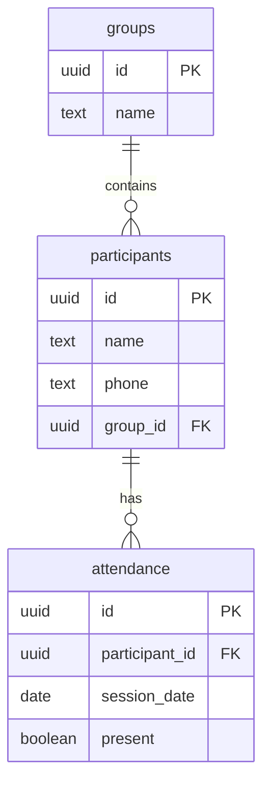

# Training Attendance App – Data Model

## 1. Overview

The application uses Supabase (PostgreSQL) to store training groups, participants and attendance records.

The MVP database contains three tables:

- `groups`
- `participants`
- `attendance`

Trainer authentication is managed separately through Supabase Auth.

## 2. Database Tables

### Table: groups

Stores the two predefined training groups.

| Column | Data Type | Constraints |
|---|---|---|
| id | UUID | Primary Key |
| name | TEXT | NOT NULL, UNIQUE |

Initial records:
- Monday / Wednesday
- Tuesday / Thursday

### Table: participants

Stores participant information.

| Column | Data Type | Constraints |
|---|---|---|
| id | UUID | Primary Key |
| name | TEXT | NOT NULL |
| phone | TEXT | Optional |
| group_id | UUID | Foreign Key → groups.id, NOT NULL |

Each participant belongs to exactly one training group.

### Table: attendance

Stores attendance records for individual participants on specific dates.

| Column | Data Type | Constraints |
|---|---|---|
| id | UUID | Primary Key |
| participant_id | UUID | Foreign Key → participants.id, NOT NULL |
| session_date | DATE | NOT NULL |
| present | BOOLEAN | NOT NULL |

A participant can have only one attendance record per date.

A unique constraint on (`participant_id`, `session_date`) prevents duplicate records.

## 3. Entity Relationship Diagram

## 4. Business Rules

1. The application contains two predefined training groups.
2. Each group can have a maximum of six participants.
3. Each participant belongs to exactly one group.
4. Attendance is recorded separately for each participant and date.
5. Attendance can be updated if the trainer makes a mistake.
6. Deleting a participant also deletes their attendance history after confirmation.

The maximum group size will be checked in the application and enforced in the database to prevent exceeding capacity.

## 5. CRUD Operations

| Entity | Create | Read | Update | Delete |
|---|---|---|---|---|
| groups | Initial setup | Yes | No | No |
| participants | Yes | Yes | Yes | Yes |
| attendance | Yes | Yes | Yes | Yes |

## 6. Security

- Supabase Auth manages trainer login.
- Row Level Security (RLS) protects all three tables.
- Only the authenticated trainer can access application data.
- Frontend code must not contain secret or service-role API keys.
- Public GitHub documentation must not contain real participant personal data.

## 7. Out of Scope

The following features are excluded from this MVP database:

- Memberships
- Payments
- Replacement training sessions
- Participant accounts
- Automated notifications

These features may be added in future versions.