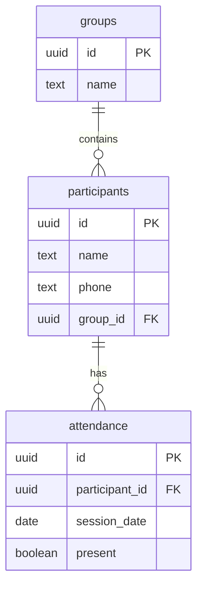

# Training Attendance App - DEMO Data Model

## 1. Overview

The DEMO uses Supabase (PostgreSQL) to store training groups, participants and attendance records. Its database contains only three tables:

- `groups`
- `participants`
- `attendance`

The DEMO has no login, registration, user accounts or Supabase Auth.

## 2. Database Tables

### Table: groups

Stores the two predefined training groups.

| Column | Data Type | Constraints |
|---|---|---|
| id | UUID | Primary Key |
| name | TEXT | NOT NULL, UNIQUE |

Initial records:
- Monday / Wednesday
- Tuesday / Thursday

Groups are predefined and are not editable through the DEMO.

### Table: participants

Stores fictional participant information.

| Column | Data Type | Constraints |
|---|---|---|
| id | UUID | Primary Key |
| name | TEXT | NOT NULL |
| phone | TEXT | Optional; fictional values only |
| group_id | UUID | Foreign Key to `groups.id`, NOT NULL |

Each participant belongs to exactly one training group. Each group has a maximum capacity of six participants.

### Table: attendance

Stores attendance records for individual participants on specific dates.

| Column | Data Type | Constraints |
|---|---|---|
| id | UUID | Primary Key |
| participant_id | UUID | Foreign Key to `participants.id`, NOT NULL |
| session_date | DATE | NOT NULL |
| present | BOOLEAN | NOT NULL |

A participant can have only one attendance record per date. A unique constraint on (`participant_id`, `session_date`) prevents duplicates. Deleting a participant also deletes their attendance history.

## 3. Entity Relationship Diagram

## 4. Business Rules

1. The database contains two predefined training groups.
2. Each group can have a maximum of six participants.
3. Each participant belongs to exactly one group.
4. Attendance is recorded separately for each participant and date.
5. Attendance can be updated or deleted if the user makes a mistake.
6. All participant data used in the DEMO is fictional.

Group capacity must be enforced by the database as well as the application, including for concurrent inserts and group changes.

## 5. CRUD Operations

| Entity | Create | Read | Update | Delete |
|---|---|---|---|---|
| groups | Initial setup | Yes | No | No |
| participants | Yes | Yes | Yes | Yes |
| attendance | Yes | Yes | Yes | Yes |

## 6. Security and Data Access

- The DEMO has no login, registration, user accounts or Supabase Auth.
- Public anonymous write access to Supabase is not permitted.
- A safe demo data-access approach must be selected before implementing database CRUD.
- The selected approach must prevent anonymous database writes and must not expose service-role keys or other privileged credentials in frontend code.
- Do not implement database CRUD until the approach is selected.
- Use fictional participant names and contact details only in demo data, screenshots and public documentation.

## 7. Out of Scope

The DEMO database does not include:

- Memberships
- Payments
- Notifications
- Replacement sessions
- User or participant accounts
